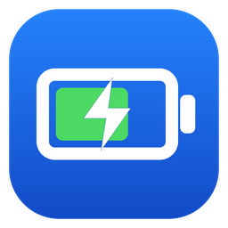
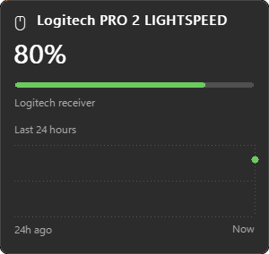
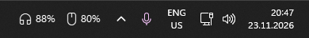

<p align="center"></p>

<h1 align="center">BatteryHub v1.7 中文版</h1>

<p align="center">
<b>BatteryHub 在 Windows 上的超轻量 Rust 实现。</b><br>
鼠标、耳机、键盘和手柄的电量，直接显示在任务栏上，<br>
内存占用仅约 <b>0.2 MB</b>。
</p>

<p align="center">
<a href="../../releases/latest"></a>
<a href="../../actions/workflows/ci.yml"></a>


</p>

<p align="center">
<br>

</p>

> [!IMPORTANT]
> **本项目是 [krisgfx9/Wireless-Device-Battery-Monitor](https://github.com/krisgfx9/Wireless-Device-Battery-Monitor)（krisgfx9 的 C++ 版 BatteryHub）的重写版**，既不是 fork，也不是原版。
> 它用 Rust 重写了原版。想法、任务栏电量条的外观以及各设备协议都来自原项目，相关功劳属于原项目作者。
>
> **原项目目前在 GitHub 上无法访问。** 2026 年 11 月 22 日，krisgfx9 账号被 GitHub 封禁，原仓库也随之下线。据原作者说并未给出理由；他已经提起申诉，因此原项目可能会回来。在此之前，原作者通过项目的 Discord 分享下载。
>
> 这个重写版**仍然不是原版**，但**它仍在维护，也会继续维护**：持续开发和更新，并根据[设备请求](../../issues)不断加入新设备。

本项目的作者是 [@ferloom](https://github.com/ferloom)，在 Claude（AI）的协助下完成。

> **本仓库（中文版）来源与致谢**
>
> - 本仓库 fork 自 **[@ferloom](https://github.com/ferloom) 的 [Wireless-Device-Battery-Monitor](https://github.com/ferloom/Wireless-Device-Battery-Monitor)**（BatteryHub v1.6 的 Rust 重写版）。
> - 再往前，原始项目是 **[@krisgfx9](https://github.com/krisgfx9) 的 [Wireless-Device-Battery-Monitor](https://github.com/krisgfx9/Wireless-Device-Battery-Monitor)**（C++ 版 BatteryHub）。
> - **想法、外观设计和全部设备协议都出自 krisgfx9 与 ferloom，在此衷心感谢两位作者的无私分享。** 完整致谢见 [CREDITS.md](CREDITS.md)。
> - 在上游 v1.6 的基础上，本仓库做了两件事：**一是把界面文字与文档翻译成简体中文；二是加入「国产小众设备适配」**（见[下文](#国产小众设备适配)）——品牌识别表、中颖 / DriverCore 两族芯片的通用探测，以及可用 `devices.ini` 自助添加设备的自定义规则。除此之外不改变原有功能，也没有删改上游的任何驱动，原有设备的表现和更新 / 回退流程保持不变。
>
> 本文档是上游英文 README 的中文翻译版，外加这项新功能的说明。上游项目：<https://github.com/ferloom/Wireless-Device-Battery-Monitor>。代码中的变量名、注册表键名、窗口类名等保持英文，以便与上游同步。

---

## 目录

[下载](#下载) · [新版本出问题？回退并反馈](#新版本出问题回退并反馈) · [功能](#功能) · [使用方法](#使用方法) · [安装、更新与卸载](#安装更新与卸载) · [与原版的资源占用对比](#与原版的资源占用对比) · [任务栏兼容性](#任务栏兼容性) · [支持的设备](#支持的设备) · [国产小众设备适配](#国产小众设备适配) · [暂不支持的设备](#暂不支持的设备) · [测试](#测试) · [从源码构建](#从源码构建) · [许可证](#许可证)

## 下载

从[**最新发布**](../../releases/latest)获取 **`BatteryHub-Taskbar-Setup-v1.7.exe`**，运行后点击 **安装**。

- 不需要管理员权限（按用户安装）。
- 已经装过？用右键菜单里的*检查更新...*，或者运行新的安装程序并点击 **更新**。
- 即使你还装着原版 C++ BatteryHub，它也不会与之冲突。
- 由于文件没有代码签名，Windows 可能显示 SmartScreen 警告：*更多信息* → *仍要运行*。
- **注意：** 菜单里的*检查更新...* 与*安装其他版本...* 仍然查询上游仓库（英文版），所以它们不会提示中文版的新版本。中文版的新版本请到本仓库的 [**Releases**](../../releases) 页下载。

## 新版本出问题？回退并反馈

如果更新之后出了什么问题，你随时可以回到旧版本：

- **从 v1.6 起：** 右键点击 BatteryHub → *安装其他版本...*（或安装程序窗口里的*其他版本...*）会列出 GitHub 上的所有发布版本；挑一个并点击 **回退到 ...**。它的下载和校验（SHA-256 校验和）与更新时相同。
- **手动：** 打开[**发布页**](../../releases)，下载较早版本的安装程序（例如 `BatteryHub-Taskbar-Setup-v1.5.exe`）并运行。它会发现你安装的较新版本，并提议用它自带的（较旧）版本重新安装。

无论哪种方式，你的警告阈值、设备名称、各项选项和电量历史都会保留。

*检查更新*永远不会提供更旧的版本，因此回退会一直生效，直到你再次更新。v1.1 之前的版本没有*检查更新*；想回到新版本，运行新的安装程序即可。

**同时也请把问题反馈出来**，见[**Issues**](../../issues/new)，这样下个版本就能修掉。最好附上：

- 出问题的版本和能用的版本（两者都显示在安装程序窗口顶部）；
- Windows 版本和任务栏样式（Windows 11、Windows 10、ExplorerPatcher：普通或小任务栏）；
- 你的设备（例如“接收器上的 Logitech PRO 2 LIGHTSPEED”、“蓝牙连接的 AirPods”）；
- 发生了什么、你期望什么，最好附一张任务栏截图。

## 功能

- **在任务栏上、紧挨时钟：** 每个设备一个图标加百分比（`🎧 27%  🖱 96%`），沿用原版的外观（Segoe Fluent Icons、Segoe UI Variable、ClearType），跟随浅色 / 深色模式和 DPI。
- **悬停某个设备**会弹出一张卡片，显示名称、电量、连接方式，以及**最近 24 小时**的曲线（充电时段为蓝色），淡入与设备间交叉淡出，效果类似任务栏的窗口预览；小部件也会像任务栏自身的按钮一样高亮。
- **设备仪表盘**（右键点击设备 → *仪表盘...*）：电量与状态、24 小时 / 3 天 / 7 天曲线（标出充电时段）、充电与放电会话，以及统计信息（典型续航、剩余时间、每小时充放电速率）。数据太少时会明确说明，而不是瞎猜。
- **7 天电量历史：** 每次变化记录一个点（至少每 10 分钟一次），保留 7 天，存放在 `%LOCALAPPDATA%\BatteryHub\Taskbar\History.bin`。BatteryHub 没运行的时间段保持空白：不会补任何数据。
- **重命名设备**（只在 BatteryHub 各处显示，设备本身不会被改动）以及 **5% 时提醒**：设备在使用电池时掉到 5% 或更低会发一次通知，充电之后才会再次提醒。
- **一眼看出充电状态：** 充电时绿色 ⚡，100% 时蓝色 ⚡，电量达到或低于设备警告阈值时百分比变红。
- **每个设备的警告阈值：** 50 / 40 / 30 / 20 / 15 / 10 / 5%。
- **立即响应**：接收器、线缆或蓝牙设备连接 / 断开时即时更新；2.4 GHz 接收器上的耳机开机 / 关机约 10 秒内更新。
- **刷新间隔**可选 1 / 5 / 10 / 30 分钟或 1 小时。
- **多显示器：** 可显示在所有显示器、仅主显示器，或仅某一台其他显示器；在每个任务栏上都紧挨该任务栏的时钟，并同时出现。
- **改为通知区域图标**（可选）：每个设备一个由 Windows 自己放置的图标，可以在其他托盘图标之间拖动，也不会与其他任务栏小部件重叠。
- **与其他任务栏小部件共存：** 当其他程序在任务栏上放置自己的小部件（网速或 CPU 监控等）时，BatteryHub 排到它的左侧而不是压在上面。
- **位置与背景：** 可以把小部件调得更远离时钟，也可以为透明任务栏加一块底板。
- **随 Windows 启动**和**自动检查更新**都能直接在菜单里开关。
- **检查更新**（菜单内），下载经过 SHA-256 校验。
- **请求支持某个设备**（菜单内）：选择一个没显示的设备，会打开一个已填好所需信息的 GitHub issue。
- **国产小众设备适配**（v1.7 新增，见[下文](#国产小众设备适配)）：内置品牌识别表、中颖 / DriverCore 两族芯片的通用探测，以及用 `devices.ini` 自助添加设备的自定义规则（菜单 → *自定义设备规则（devices.ini）...*）。
- **体积极小：** 空闲时内存约 0.1–0.2 MB（任务管理器的“内存”列），每分钟约 0.1 秒 CPU。
- **只允许运行一份：** BatteryHub 已在运行时再次启动不会有任何动作。
- **左侧或右侧任务栏**（Windows 11）：小部件变成通知区域上方的一列，悬停卡片在任务栏旁边弹出。
- **安全回退：** 遇到未知的资源管理器布局时回退到通知区域图标。

## 使用方法

| 电量条上的样子 | 含义 |
|---|---|
| **红色**百分比 | 达到或低于该设备的警告阈值（默认 15%） |
| **绿色 ⚡** | 已接电，正在充电 |
| **蓝色 ⚡** | 已接电，已充到 100% |
| 变暗 | 休眠（接收器仍插着），显示最后已知电量 |

左键点击不做任何事（这是有意的：电量条尽量不碍事）。**右键**打开菜单：

| 菜单项 | 作用 |
|---|---|
| *设备名（电量、状态）* ▸ | *仪表盘...*、*电量历史*、*统计*（仪表盘对应标签页）、*重命名设备...*、*低于等于* 50 / 40 / 30 / 20 / **15** / 10 / 5% 时红色警告，以及 *5% 时提醒（通知）*（默认**开**） |
| *刷新设备* | 完整重新扫描；已消失的设备会移除 |
| *刷新电量* | 重新读取电量 |
| *电量刷新间隔* ▸ | **1 分钟** / 5 / 10 / 30 分钟 / 1 小时 |
| *设备连接或断开时刷新* | 默认**开**；见下文 |
| *显示为通知区域图标（由 Windows 排列）* | 默认**关**。不显示电量条，而是每个设备一个通知区域图标，里面画着电量。Windows 会像排列其他图标一样排列它们：可以拖动改变顺序，也可以拖进或拖出隐藏图标区。新图标一开始藏在 ^ 后面（Windows 11 对每个应用都这样）：把它拖到任务栏上，或者在*设置 → 个性化 → 任务栏 → 其他系统托盘图标*里打开一次；Windows 会按设备记住这个选择 |
| *任务栏文字底层背景（用于半透明任务栏）* | 默认**关**。在小部件后面加一块任务栏颜色的圆角底板，让它在透明任务栏（TranslucentTB、Windhawk Taskbar Styler 等）上依然清晰可读 |
| *任务栏上的位置* ▸ | **紧邻通知区域**，或距其 20 到 200 像素（每 20 像素一档），例如为另一个任务栏小部件（iCUE、网速监控等）让出空间。在其他显示器上同样生效。手动设置的值（`TaskbarOffset`）显示为*自定义* |
| *任务栏上的高度* ▸ | 上移 5 / 10 / 15 像素、**居中**，或下移 5 / 10 / 15 像素。在其他显示器上同样生效。手动设置的值（`TaskbarOffsetY`）显示为*自定义* |
| *小部件显示在* ▸ | 仅在多显示器时出现：*所有显示器* / **仅主显示器** / *仅显示器 2（左侧）*... 显示器按其身份记忆，而不是编号；它未连接时小部件显示在主任务栏上。其他显示器需要 Windows 里的*在所有显示器上都显示我的任务栏*（其他程序的任务栏，例如 DisplayFusion，不受支持） |
| *随 Windows 自动启动* | 添加或删除 BatteryHub 的启动项（`HKCU\Software\Microsoft\Windows\CurrentVersion\Run\BatteryHub Taskbar`） |
| *自动检查更新* | 默认**关**。开启后，BatteryHub 在启动约 2 秒后检查一次 GitHub（运行期间不检查；如果网络还没就绪，会每 15 秒重试一次，最多 8 次）；若有新版本，会弹出与*检查更新...*相同的问题 |
| *静默安装更新* | 默认**关**；需要开启自动检查。当检查发现新版本时，BatteryHub 会下载、校验其 SHA-256 校验和并在后台安装：不询问、不显示安装程序窗口、不弹“更新完成”提示。设置和开机启动项都会保留。 |
| *请求支持某个设备...* | 列出 BatteryHub 能看到的所有设备（HID、USB 和蓝牙；厂商专用接口和音频设备排在最前）。选择你的设备，核对名称和类型，加上备注，然后*发送*会在浏览器中打开一个新的 GitHub issue，内容与窗口显示的完全一致：名称、类型、你的名字（可选，issue 是公开的）、备注、厂商 / 产品 ID、HID 与 USB 接口摘要、Windows 版本号。由你在那里提交（需要 GitHub 账号）；程序本身不会发送任何内容。*复制完整报告*会复制同样的内容，外加所有设备的列表。也可以使用 `batteryhub-taskbar.exe --report` |
| *安装其他版本...* | 打开安装程序里的 GitHub 发布列表，可回退到更旧的版本（或安装更新的版本） |
| *检查更新...* | “没有新更新”，或“有新更新可用：v1.1 → v1.x - 现在更新吗？”。选择*是*会下载安装程序、用该发布的 SHA-256 校验和核对后启动；它会更新并重启 BatteryHub，保留你的设置和开机启动项 |
| *退出* | 关闭 BatteryHub |

悬停卡片和菜单跟随任务栏主题（深色或浅色）；*请求支持*窗口跟随 Windows 应用主题。

**设备来去时**（在*设备连接或断开时刷新*开启的前提下）：

| 事件 | 显示延迟 |
|---|---|
| USB 接收器 / 线缆插入或拔出 | 约 1–3 秒（Windows 设备通知；每次读取也会检查 HID 设备集合是否变化） |
| 蓝牙设备（AirPods、耳机、手柄）连接或断开 | 几秒（每 3 秒检查一次连接）；AirPods 只在连接本机时显示 |
| 2.4 GHz 接收器上的耳机开机或关机 | 约 10 秒（耳机接收器每 10 秒检查一次） |
| 鼠标 / 键盘休眠，接收器仍插着 | 保持显示，变暗，并显示最后电量 |
| 电脑唤醒 | 几秒 |

## 安装、更新与卸载

自 v1.6 起，安装程序是一个 Windows 11 风格的窗口。它先检查这台电脑上的情况（已安装的版本及其位置、是否正在运行、原版 C++ BatteryHub——后者它从不触碰），然后给出唯一合适的操作：

| 按钮 | 何时出现 | 作用 |
|---|---|---|
| **安装** | 尚未安装 | 安装，并创建开始菜单快捷方式，另有*桌面快捷方式*、*登录 Windows 时自动启动*和*安装完成后启动 BatteryHub* 三个选项 |
| **更新到 ...** | 已安装较旧版本 | 替换程序并保留你的设置、历史和开机启动项；若它正在运行则重启它 |
| **重新安装** | 已安装相同版本 | 重新写入程序（修复损坏的安装） |
| **回退到 ...** | 已安装较新版本 | 安装本安装程序自带的较旧版本，保留你的设置 |
| **其他版本...** | 总是可见 | 列出 GitHub 上的所有发布版本；选中的版本会被下载、用 SHA-256 校验和核对后安装 |
| **卸载...** | 已安装 | 关闭 BatteryHub，从所有开机启动位置、快捷方式、文件和“设置 → 应用”条目中移除它。除非你勾选*同时删除我的设置和电量历史*，否则你的设置和电量历史**会保留** |

新程序文件先写在旧文件旁边、读回并校验（SHA-256），确认无误后才替换，因此写入失败也不会留下损坏的安装。只会关闭从安装目录启动的 BatteryHub 进程。*显示详情*会显示日志，日志同时保存到 `%TEMP%\BatteryHub-Setup.log`。

BatteryHub 也会出现在**设置 → 应用 → 已安装的应用**中（名称、版本、发布者、大小），那里的*卸载*会打开同一个窗口。

给脚本用的命令行：`/install`、`/update`、`/uninstall`、`/S`（静默）、`/autostart=yes|no`、`/desktop=yes|no`、`/nolaunch`、`/nonotify`（结束后不弹“更新完成”）、`/purge`（卸载时同时删除设置和历史）、`/versions`（打开版本列表）。

| 文件放在哪里 | |
|---|---|
| 程序 | `%LOCALAPPDATA%\Programs\BatteryHub\Taskbar\batteryhub-taskbar.exe`，外加 `BatteryHub-Setup.exe`（“设置”里*卸载*所运行的那份安装程序副本） |
| “设置 → 应用”条目 | `HKCU\Software\Microsoft\Windows\CurrentVersion\Uninstall\BatteryHub Taskbar` |
| 快捷方式 | 桌面，以及 `Start Menu\Programs\BatteryHub\BatteryHub Taskbar.lnk` |
| 设置 | `HKCU\Software\BatteryHub\Taskbar`：`Thresholds`（按设备）、`RefreshMinutes`、`RefreshOnDeviceChange`、`TaskbarOffset`（DWORD，距时钟的像素）、`TaskbarOffsetY`（DWORD，上下偏移像素，+ 为向下）、`WidgetMonitor`（`all`、`main` 或某个显示器 id）、`WidgetBackground`、`AutoCheckUpdates`、`SilentUpdates`、`NotificationIcons`、`History`（二进制，最近 24 小时的电量） |
| 开机启动 | `HKCU\...\Run` → `BatteryHub Taskbar`（如果你选择了它） |

原版 C++ BatteryHub 使用不同的名称（`Program Files\BatteryHub`、`HKCU\Software\WirelessBattery`、启动项 `WirelessBattery`），本程序从不触碰它们。

## 与原版的资源占用对比

两个程序在**同一台电脑上并排运行**，连接同样的设备（Logitech LIGHTSPEED 鼠标、SteelSeries 2.4 GHz 耳机接收器、蓝牙），使用默认设置（每分钟刷新），启动后每 2 秒采样一次，持续 3 分钟。方法、原始采样和更早的结果见 [bench/RESULTS.md](bench/RESULTS.md)。

| | **BatteryHub（Rust）v1.1** | BatteryHub（C++）1.1.0 | |
|---|---:|---:|---:|
| **任务管理器“内存”列**中位数 | **0.20 MB** | 4.66 MB | **少 23 倍** |
| 任务管理器“内存”平均值 / 最大值 | 0.33 / 0.82 MB | 4.65 / 4.92 MB | |
| 工作集（含共享系统 DLL） | **1.3 MB** | 27.5 MB | 少 21 倍 |
| 专用字节（提交） | **4.6 MB** | 6.0 MB | |
| 每分钟 CPU 时间 | **0.11 秒** | 0.88 秒 | 少 8 倍 |
| 线程数 | **9** | 15 | |
| 句柄数 | 367 | 375 | |
| 程序文件大小 | **约 500 KB** | 1,958 KB | 小 4 倍 |

**v1.5**（多了约 40 个设备驱动、悬停卡片及其 24 小时历史）：程序 867 KB，安装程序 1.6 MB。一次 90 秒的检查中，任务管理器“内存”中位数为 **0.12 MB**，读取设备时短暂冲到约 1 MB。

让它保持小巧的做法：只在某一刻需要的内存（一次读取、一次蓝牙检查）用完后立即交还 Windows；设置改为缓存；蓝牙 LE 只在读取时监听；设备列表会被缓存，只有变化时才重新扫描；只枚举蓝牙设备节点；Xbox 输入 API 和 WinHTTP 只在需要时加载。

**公道地说：** 原版有更多设备驱动（约 100 个）、品牌配色和更多选项。差异有一部分来自“代码更少、做的事更少”，并不只是语言不同。

## 任务栏兼容性

电量条是一个放在任务栏内、通知区域左侧的小型分层窗口，使用的技术与原版相同。它依赖资源管理器的窗口布局，因此 BatteryHub 每秒检查一次并在必要时安全回退：

| 情况 | BatteryHub 的做法 |
|---|---|
| Windows 11、Windows 10、ExplorerPatcher（也包括 Windows 10 小任务栏） | 电量条紧挨时钟；在 Windows 10 布局下会收窄任务按钮，使其不会被滑到电量条下面 |
| 资源管理器重启 | 在新任务栏上重建且只重建一条电量条（每秒清理游离的电量条窗口） |
| 任务栏高度、DPI 或主题变化（例如退出全屏后） | 重新绘制电量条 |
| 垂直任务栏（Windows 11 左侧或右侧） | 电量条变成通知区域上方的一列；悬停卡片在任务栏旁边弹出 |
| 未知的资源管理器布局，或电量条 3 秒仍无法就位 | **每个设备一个通知区域图标**（图标里画着电量、简短提示和同样的菜单），恢复可能后再换回电量条 |

## 支持的设备

| 系列 | 说明 |
|---|---|
| Logitech | 通过 Unifying、Bolt、LIGHTSPEED、蓝牙和 USB 使用 HID++ 1.0 / 2.0，另含 G 系列耳机（电压曲线） |
| SteelSeries | Arctis 1 / 7 / 9 / Pro、Arctis Nova（3P、5、7、7+、Pro）、GameBuds、Aerox、Prime、Rival |
| Razer | 鼠标、键盘和接收器（90 字节 feature report 协议）；BlackShark V3 耳机通过其 HyperSpeed 接收器 `1532:057A` 或 USB 线缆 `1532:0579`（协议来自 OpenRazer PR #2794 和 Joule）；BlackShark V2 Pro（2023）通过其 HyperSpeed 接收器 `1532:0555`（协议来自 OpenRazer PR #2862 和 [blackshark-battery](https://github.com/matej-basic/blackshark-battery)，MIT）；Barracuda X Chroma 通过其 2.4 GHz 接收器 `1532:0574`（协议来自 [batterywatch](https://github.com/itayavra/batterywatch)，GPL-3.0）；Nari 通过其 2.4 GHz 接收器 `1532:051C`（请求与应答来自 [RazerNariBatteryLevel](https://github.com/Modzeleczek/RazerNariBatteryLevel) 的 Synapse 抓包，字段布局来自 [HaloBattery](https://github.com/HeyOkay/HaloBattery)（MIT）和 [BrimDeck](https://github.com/MoFeng2223/BrimDeck)（Apache-2.0）；电量分级较粗，充电时不报电量） |
| ASUS ROG Pelta | 耳机通过其 2.4 GHz 接收器 `0B05:1B84` 或 USB 线缆 `0B05:1B82`（协议来自 [pelta-control](https://github.com/jimm0thy/pelta-control)，MIT，源自 Armoury Crate 的抓包，原版 C++ BatteryHub 也这样实现） |
| Redragon（Areson） | M913 Impact Elite、M915RGB-WL 及其他使用“2.4G Wireless Receiver” `25A7:FA07` / `FA08` 的设备；电量以 10% 为步进（协议由原版 C++ BatteryHub 依据 Redragon 软件的抓包记录，另见 [m913-ctl](https://github.com/Qehbr/m913-ctl) 和 [redragon-m913-battery-tray](https://github.com/Doomguy-BFG9000/redragon-m913-battery-tray)） |
| Corsair | Void 系列耳机，含 HS70 Pro Wireless `1B1C:0A4F`（通过 2.4 GHz 接收器；协议来自 [HeadsetControl](https://github.com/Sapd/HeadsetControl) 和 Linux 的 `hid-corsair-void` 驱动） |
| Endgame Gear 4K | OP1w 4k（v1 / v2）和 XM2w 4k（v1 / v2），使用 4K 接收器 `3367:1970`（只读 feature report `A1`，电量命令 `B4`；协议来自 [vole](https://github.com/johanneszab/vole)（MIT）和 [Endgame_Gear_Web_Configurator](https://github.com/Janlhin/Endgame_Gear_Web_Configurator)（GPL-3.0）；无充电指示） |
| MCHOSE 键盘（3033 接收器） | G75 V2、G87 V2、K99 V3 使用通用接收器 `3837:3033`（“GLW”功能配置读取来自 MCHOSE 的 M HUB，原版 C++ BatteryHub 有记载；最多每 10 分钟询问一次；同一接收器上的 K87S 使用另一套协议，不读取） |
| SinoWealth 接收器 | Redragon M602-KS、M690 Pro 及其他使用 SinoWealth 通用接收器 `258A:002F` 的鼠标（由 NeroHole 贡献，[#111](../../pull/111)；协议见 [BatteryTray](https://github.com/qu1ncky/BatteryTray)（MIT）和 OpenMouse 的 M690 Pro 记录；无充电指示） |
| Corsair（Bragi） | 接收器 `1B1C:0A64` 上的 Virtuoso XT、`1B1C:0A97` 上的 HS80 MAX Wireless，以及 Bragi 接收器 `0A62` / `0A3E` / `0A3D` 上的耳机（只读的 Bragi GET 读取电量与充电属性，原版 C++ BatteryHub 有记载；这里未实测） |
| ATK 耳机（串口） | ATK N9 Pro（接收器 `373B:11CB`、线缆 `11CA`）和第一代 N9 Ultra（`1204` / `1203`），像 ATK HUB 那样通过接收器的 USB 串口读取（协议细节来自 [myfinder-device-battery](https://github.com/wushuai0802/myfinder-device-battery) 和原版 C++ BatteryHub；ATK 自己的程序占用该串口时不读取） |
| AULA / MCHOSE | AULA F75 / F87 Pro / F99（Pro）以及 MCHOSE 键盘，使用“BY”接收器 `3554:FA09` / `3554:FB40` / `41E4:2001`（协议来自 [Device-Battery-Info](https://github.com/PyFlat/Device-Battery-Info)、[womier-l65-linux](https://github.com/deepan-alve/womier-l65-linux) 和 MCHOSE 的 M HUB，原项目已汇总）；MCHOSE 鼠标（K7、L7、M7、A7）使用 VID `5253`，以及接收器 `3837:1001`（K7 Ultra）/ `100A` / `100B` / `100C` / `1012`（协议来自 [mchose-linux](https://github.com/alexfrih/mchose-linux)；`3837` 的 ID 来自原项目）；MCHOSE V9 Pro 耳机 `291D:385D`（协议来自 [HaloBattery](https://github.com/HeyOkay/HaloBattery)，MIT） |
| ATK Mercury | Mercury I / M1 耳机，使用 2.4 GHz 接收器 `373B:107C`，耳机固件 0007（协议来自 [Joule](https://github.com/DillanCidral/Joule) PR #79，已在真机验证，以及 [TaskbarVitals](https://github.com/symNistaken/TaskbarVitals)；无充电状态） |
| ATK / VXE | 使用 NK mouse NANO 接收器 `373B:1216` 的鼠标（例如 ATK A9 PLUS 2.0、VXE R1 NK；协议来自 [HaloBattery](https://github.com/HeyOkay/HaloBattery) 和 [mouse-battery](https://github.com/qwr79/mouse-battery)） |
| Darmoshark | M3 和 M3S，使用其 Telink 2.4 GHz 接收器 `248A:FF30` / `248A:FF31`（协议来自 [darmoshark-m3-configurator](https://github.com/Barba2k2/darmoshark-m3-configurator)，MIT；M3S 的 ID 来自原项目） |
| VGN / VXE / ATK 键盘（Evision） | VGN S99、V98 PRO、V98pro V2、N75 PRO、VXE75（V2）、VXE V87、ATK V75X 以及“Wireless Gaming Keyboard”（例如 Feker Alice80），使用 2.4 GHz 接收器 `320F:5088` 或 USB 线缆 `320F:5055`（协议来自 [HaloBattery](https://github.com/HeyOkay/HaloBattery)（MIT）和 VGN HUB，原项目已汇总） |
| Pulsar / Kysona / VXE / LAMZU（CompX） | Pulsar X2 V2 / X2H / X2A / Xlite V3（`3554:F507` / `F508` / `F509`）、Kysona M600（`F57C` / `F57D` / `F5D5`）、VXE R1 SE+（`373B:1085`、`3554:F58F`）、VXE Dragonfly R1 Pro（Max）（接收器 `3554:F58A`、线缆 `F58C`）、LAMZU Atlantis / Thorn 这一代使用 LAMZU 4K 接收器（`3554:F510`，线缆 `F50F`）（协议来自 Linux 的 `hid-pulsar` 驱动、[vxe-r1-pro-max-battery](https://github.com/S1berla/vxe-r1-pro-max-battery) 和 [HaloBattery](https://github.com/HeyOkay/HaloBattery)，MIT） |
| Scyrox / ATK 8K（CompX） | Scyrox V6 / V8 使用 SCYROX 8K 接收器 `3554:F5F7` 或 USB 线缆 `3554:F5F6`；ATK 鼠标（例如 Fire X 8K）使用 ATK Mouse 8K 接收器 `373B:101B`，ATK A9 Ultimate / F1 V2 使用“8k dongle-L” `373B:11D9`（CompX report 8；ID 与协议来自 [HaloBattery](https://github.com/HeyOkay/HaloBattery) 和 [MouseDock](https://github.com/late-autumn-gif/mousedock)（均 MIT），以及 [BrimDeck](https://github.com/MoFeng2223/BrimDeck)（Apache-2.0）） |
| AULA 鼠标 | X9 Ultra、V9 / V9 Max+ 及其他 AULA 鼠标，使用 AULA-8K 接收器 `320F:22A0`（协议来自 [HaloBattery](https://github.com/HeyOkay/HaloBattery)（MIT）和原版 C++ BatteryHub） |
| MCHOSE（较新鼠标） | K7 V2 Ultra+、A7 V3 Ultra+ 及其他鼠标，使用 MCHOSE 较新的接收器 `3837:1014` / `1018` / `1016` / `102C` / `102D`，K7 V2 Ultra+ 线缆 `3837:4028`（M HUB 的设备信息读取，见 [MchoseBatteryTray](https://github.com/HifumiDaisuki01/MchoseBatteryTray)（MIT）和原版 C++ BatteryHub） |
| AJAZZ AJ139 V2 MC | 使用其 2.4 GHz 接收器 `A8A5:2255` 或 USB 线缆 `A8A4:2255`（协议来自 [ajazz-aj139-macos](https://github.com/werquess/ajazz-aj139-macos)，MIT） |
| Jabra | Jabra Link 390 接收器 `0B0E:2E50` / `2E51` / `2E56` / `2E57` 后面的耳机（GN Protocol，见 [HeadsetControl](https://github.com/Sapd/HeadsetControl)（GPL-3.0）和原版 C++ BatteryHub） |
| Rongyuan 接收器 | Attack Shark 网页驱动所用 Rongyuan 2.4 GHz 接收器上的鼠标和键盘（88 个 ID，例如 Attack Shark R3 `3151:402D`、EWEADN GS01 `3151:5031`、AJAZZ、Akko Air 01）（协议来自 [BatteryTray](https://github.com/qu1ncky/BatteryTray)，MIT） |
| SONiX 键盘 | AULA F108 Pro、AJAZZ AK820 MAX 和 AJAZZ AK35I Pro V3 使用 `05AC:024F` 接收器，AJAZZ AK980 V2 / AK820 Pro 使用 `0C45:FEFE` / `0C45:FDFD`，仅在 2.4G 模式下可用（协议来自 [sonix-keyboard-studio](https://github.com/donglover69/sonix-keyboard-studio)、[ak820-rs](https://github.com/deddroid/ak820-rs) 和 [ak820-studio](https://github.com/usharik/ak820-studio)） |
| WLMOUSE | Beast X、Beast X Mini、Mini Pro 和 Max，通过各自的接收器读取（协议来自 [HaloBattery](https://github.com/HeyOkay/HaloBattery)，MIT） |
| DriverCore 鼠标（VID `373E`） | 共用 `373E` 厂商 ID 并使用其 65 字节状态 feature report 的鼠标，例如“R6 Mouse 2.4G” `373E:0022`、LAMZU 和 Arbiter Studio 的接收器（WLMOUSE 状态查询，原版 C++ BatteryHub 依据 LAMZU / Arbiter 网页驱动记录，GPL-3.0） |
| Flydigi | Apex 6 / Apex 6 Pro `37D7:2502`，通过 2.4 GHz 接收器或线缆（协议来自 [SDL](https://github.com/libsdl-org/SDL) 的 `SDL_hidapi_flydigi.c`，zlib） |
| HyperX | Cloud III S Wireless 耳机，通过其 2.4 GHz 接收器 `03F0:06BE` / `03F0:02CC`（协议见 [HyperX-Battery-Tray](https://github.com/GuacamoleGH/HyperX-Battery-Tray)、[hyperx-battery-logger](https://github.com/OZX-OG/hyperx-battery-logger) 和 [HyperHeadset](https://github.com/LennardKittner/HyperHeadset)，均 MIT） |
| HyperX Cloud II Core Wireless | 通过其 2.4 GHz 接收器 `03F0:0995`（第二个 ID `03F0:0795`）（协议来自 [HaloBattery](https://github.com/HeyOkay/HaloBattery) 和 [HyperHeadset](https://github.com/LennardKittner/HyperHeadset)，均 MIT） |
| HyperX Cloud Flight | 通过其 2.4 GHz 接收器 `0951:1723`（以及 `0951:16C4`）；电量以 5% 为步进，充电时不报电量；由 [estebannoemr](https://github.com/estebannoemr) 在 #93 贡献并在真机测试（协议来自 [hyperx-cloud-flight](https://github.com/kondinskis/hyperx-cloud-flight) 和 [hyperx-cloud-flight-wireless](https://github.com/srn/hyperx-cloud-flight-wireless)，均 MIT） |
| HyperX（较早耳机） | Cloud Stinger Core Wireless（`0951:170B`，PlayStation 接收器 `0951:1713` / `03F0:0A93` / `03F0:0B93`）和 Cloud Alpha Wireless（`03F0:098D`），通过各自的 2.4 GHz 接收器（协议来自 [HeadsetControl](https://github.com/Sapd/HeadsetControl)（GPL-3.0）、[HyperHeadset](https://github.com/LennardKittner/HyperHeadset)（MIT）和 [HyperBatteryMonitor](https://github.com/davidsantanaalves/HyperBatteryMonitor)（MIT），原版 C++ BatteryHub 也这样实现） |
| Logitech G321 | G321 LIGHTSPEED 耳机，通过其 2.4 GHz 接收器 `046D:0B39`；由 [Bacurovisk](https://github.com/Bacurovisk) 在 #107 贡献并在真机测试（协议来自 [G321 Studio](https://github.com/gleyssonsc/g321-studio)，MIT） |
| Logitech G PRO X 2 | PRO X 2 LIGHTSPEED 耳机，通过其 2.4 GHz 接收器 `046D:0AF7`（Logitech 的“Centurion”传输层，见 [HeadsetControl](https://github.com/Sapd/HeadsetControl)（GPL-3.0）、[Solaar](https://github.com/pwr-Solaar/Solaar) 和 [HaloBattery](https://github.com/HeyOkay/HaloBattery)（MIT）） |
| Logitech G533 | 耳机通过其接收器 `046D:0A66`，使用固定的 HID++ 电量请求读取（协议与电压标定来自 [HeadsetControl](https://github.com/Sapd/HeadsetControl)，GPL-3.0） |
| ZOWIE | DW 系列鼠标（FK2-DW、U2-DW、S2-DW、EC-DW 等）使用 DW 接收器 `04A5:800A`，ZOWIE U2 使用 `04A5:8008`；电量由电池电压估算，是否在充电座上则由其趋势推断（协议来自 [zowie-battery-tray](https://github.com/IgnacioBarb/zowie-battery-tray)，MIT，原版 C++ BatteryHub 也这样实现） |
| Keychron | 鼠标（M1、M2、M3、M3 mini、M6、M7）使用 Keychron Link 接收器 `3434:D030` / `3434:D031`；键盘只有在刷了 `KC_GET_BATTERY` 固件补丁后才支持（[ldkv/qmk_firmware#1](https://github.com/ldkv/qmk_firmware/pull/1)），因为原厂键盘固件只通过蓝牙上报电量（协议见原版 C++ BatteryHub，GPL-3.0） |
| ROCCAT | Syn Max Air 耳机，通过其 2.4 GHz 接收器（电压曲线；充电时电量较粗） |
| FNATIC | BOLT 鼠标通过其接收器 `2F0E:0203`（USB 线缆 `2F0E:0204` 只用于标记“正在充电”）；由 [Jere2201](https://github.com/Jere2201) 在 #48 根据 USBPcap 抓包贡献，并在真机测试 |
| Attack Shark / Delux / Inphic | 鼠标（例如 X1、X11）使用 Xenta 2.4 GHz 接收器 `1D57:FA60`（协议来自 [Attack Shark Battery KDE](https://gitlab.com/gabriel17166/Attack-Shark-Battery-KDE) 和 [attackshark-battery-windows](https://github.com/daeoxide/attackshark-battery-windows)，均 MIT）；Delux M900 Pro 和 Inphic IN10 (R) MAX 使用 `1D57:FA65` 接收器（报文来自 [omarchy-delux-m900](https://github.com/AeonArcHQ/omarchy-delux-m900)（MIT）和原项目） |
| Sony | DualShock 4、DualSense、DualSense Edge（USB 和蓝牙） |
| Apple | AirPods 和 Beats，通过 BLE 近距广播读取（左 / 右 / 充电盒） |
| 蓝牙 | Windows 知道电量的任何设备，另加 Google Fast Pair 的左 / 右 / 盒电量拆分 |
| 通用 HID | 暴露标准 Battery Strength usage 的设备 |
| Xbox | Windows.Gaming.Input（精确百分比）和 XInput（较粗分级） |

设备没显示？用右键菜单里的*请求支持某个设备...*（见上文）。原项目里的更多品牌可以每个文件一款地加到 `src/drivers/`；欢迎提交 pull request（ROCCAT、FNATIC BOLT 和 HyperX Cloud Flight 驱动就是这样来的）。可以用 `HKCU\Software\WirelessBattery\IgnoreDevices`（`VID:PID` 列表，与原版同一项设置）排除设备。

## 国产小众设备适配

国内大量无线外设是贴牌的：同一个接收器换个外壳、换个品牌名、换个 USB ID 就上市，公开的协议资料往往只有大牌才有。从 v1.7 起，本仓库在原有驱动之外加了三层“兜底”，专门照顾这类设备——**全部只读**（读 feature / input 报告），认不出就什么都不做，绝不向设备写配置：

| 层 | 做什么 | 覆盖谁 |
|---|---|---|
| **品牌识别表**（`src/brands.rs`） | 用 USB 厂商号和产品串里的中英文关键词，给设备补上中文品牌名与类型：雷柏、双飞燕、达尔优、黑爵、狼蛛、迈从、攻击鲨、达摩鲨、万灵、ATK 艾石头、英菲克、富勒、摩豹、前行者、飞智、八位堂、机械师、雷神、华为、小米、联想……，以及中颖 / 合泰 / 凌阳 / Xenta / 亦讯 / Areson / DriverCore 这些常被贴牌的方案商 | 原来只显示 “Wireless device / ?” 的白牌设备 |
| **芯片族通用探测**（`src/drivers/chipfamily.rs`） | 不看 VID:ID，只看 HID 集合的“形状”，再按应答格式校验：中颖方案（`FF00:0001`、8 字节 feature 报告）、DriverCore `373E` 一族（`FFFF`、65 字节 feature 报告）。答不上来立刻放弃，探测过的设备 10 分钟内不再打扰 | 换 ID 不换方案的白牌 2.4 GHz 接收器 |
| **自定义设备规则**（`devices.ini`） | 你自己写一条规则，说明“先发哪一帧查询、读哪个报告、电量在第几个字节、怎么换算”，BatteryHub 就照做 | 内置驱动与上面两层都没覆盖的设备 |

### 自定义设备规则 `devices.ini`

文件在 `%LOCALAPPDATA%\BatteryHub\Taskbar\devices.ini`：

- 第一次需要时（右键菜单 → **自定义设备规则（devices.ini）...**，或运行 `batteryhub-taskbar.exe --rules`）会自动写出一份带中文说明的模板，可以用记事本直接改；
- 改完保存就生效，下一次读电量时用上（默认 1 分钟，或者右键 → *刷新电量*），不用重装、不用重启；
- 模板整段都是注释，所以打开时是 0 条规则，不会凭空多出设备；写错的规则只会被跳过，并在打开文件时列出来告诉你第几行。

一条完整的例子（白牌接收器：先发 `05 90` 查询帧，电量在 `05` 号报告的偏移 3）：

```ini
[我的白牌鼠标]
vid=24AE
pid=2000
usage=FF00:0001
report=feature
report_id=05
query=05 90
wait_ms=120
offset=3
scale=raw
charging_offset=2
charging_value=10
zero_off=1
kind=mouse
name=我的雷柏鼠标
```

| 键 | 必填 | 说明 |
|---|---|---|
| `vid` / `pid` | ✔ | USB 厂商号 / 产品号，十六进制 |
| `offset` | ✔ | 电量字节下标，**从报告 ID 起算**（0 就是报告 ID 自己） |
| `usage` | | 只在 `页面:用途` 为该值的集合上读；不写就在厂商集合（`FF00`–`FFFF`）里找 |
| `report` | | `feature`（默认）或 `input` |
| `report_id` | | 报告 ID，默认 `0` |
| `query` | | 读取前先发的查询帧（十六进制字节）；不需要就不写 |
| `wait_ms` | | 发完查询帧等多少毫秒再读，默认 `100` |
| `scale` | | `raw`（0–100，默认）/ `full255`（0–255 按比例）/ `minmax`（配合 `range=最小值,最大值`，例如电压） |
| `charging_offset` + `charging_value` | | 该字节等于这个值就算“充电中”，两者要一起写 |
| `zero_off` | | 电量为 0 当作“设备已关机”（接收器在，设备没开） |
| `kind` | | `mouse` / `keyboard` / `headset` / `gamepad` / `phone` / `microphone` / `other`（也认中文） |
| `name` | | 显示名；不写就用设备自己的产品串 |
| `force` | | `force=1` 时这条规则排在所有内置驱动之前（内置驱动认错型号时用） |

字节位置怎么找：运行 `batteryhub-taskbar.exe --listen VID:PID`（例如 `--listen 24AE:2000`），它会把该设备每个 HID 集合的输入 / feature 报告打印到一个记事本文件里，字节顺序和 `offset` 的算法一致；那一步只读，不向设备写任何东西（唯一会“写”的地方是你自己写在规则里的 `query`）。

适配好了欢迎把规则贴到 [Issues](../../issues/new)：下一版就能做成内置驱动，别人也不用再自己写。

## 暂不支持的设备

这些是被请求过但目前无法支持的设备，以及原因。其中大多数仍可以通过**蓝牙**显示电量（如果设备支持）：只要 Windows 在*设置 → 蓝牙和设备*里显示电量，BatteryHub 就会显示。如果你知道其中某款设备如何上报电量（抓包、能读取它的项目），请在其 issue 下留言；`batteryhub-taskbar.exe --listen VID:PID` 会记录接收器发来的内容，且不会向它发送任何东西。手上就有其中一台的话，也可以先用[自定义设备规则](#自定义设备规则-devicesini)自己把电量读出来：`devices.ini` 里写一条规则即可，不用改代码、不用等新版本。

| 设备 | VID:PID | 原因 | Issue |
|---|---|---|---|
| Logitech G435 耳机（LIGHTSPEED） | `046D:0ACB`、`046D:0ADF` | 它的接收器只在 bootloader 模式下给出电量，而这会中断音频；BatteryHub 从不触碰它。通过蓝牙可以。 | [#10](../../issues/10)、[#56](../../issues/56)、[#92](../../issues/92)、[#119](../../issues/119)、[#138](../../issues/138) |
| Havit Fuxi-H3，以及 Redragon / Rexus / Ardor 耳机里的同款接收器 | `040B:0897` | 该接收器只发送音量 / 静音按键；Havit 自家程序用的命令未知 | [#6](../../issues/6)、[#79](../../issues/79) |
| Mad Dog GH750K、IO Graphite 2 Pro Wireless（JieLi 接收器）、“GAMING HEADSET B2”、无品牌的 G435 仿品、Attack Shark L80 Pro、“TA3000”耳机 | `4C4A:4155`、`3634:4155` | 没有公开的电量查询方式；接收器的厂商通道属于音频芯片（固件 / 设置），因此不去猜命令 | [#1](../../issues/1)、[#30](../../issues/30)、[#97](../../issues/97)、[#114](../../issues/114)、[#120](../../issues/120)、[#132](../../issues/132) |
| Bloody MR710 耳机 | `10D6:4801` | 这颗 Actions 芯片的接收器只有音频、媒体键和芯片自身通道；没有公开的电量查询方式。通过蓝牙可用，前提是 Windows 显示电量。 | [#31](../../issues/31) |
| 8BitDo Ultimate 2C Wireless（X-input 模式） | `2DC8:310A` | 该接收器在 Windows 看来是有线 Xbox 手柄（没有电量），其配置通道的电量读取只对其他 8BitDo 型号有说明；因此不去猜命令 | [#106](../../issues/106) |
| UGREEN 2.4 GHz 接收器 | `2B89:0043` | 该接收器没有电量或链路状态通道（UGREEN 自家软件也不读）。通过蓝牙可用，前提是 Windows 显示电量。 | [#108](../../issues/108) |
| 8BitDo Retro Mechanical Keyboard 接收器 | `2DC8:5201` | 没有公开的电量命令；它的厂商通道同时也是固件更新通道，因此不去猜命令 | [#5](../../issues/5) |
| Mojhon Storm / BIGBIG WON 手柄 | `E2B7:122C` | 不上报电量的 XInput 接收器 | [#8](../../issues/8) |
| Rapoo VT9PRO 4K | `24AE:1211` | 没有公开的协议 | [#11](../../issues/11) |
| Edifier HECATE G5 Wireless | `35BB:A008` | 其耳机接收器没有公开协议（受支持的 HECATE 鼠标用的是其他 ID） | [#15](../../issues/15)、[#131](../../issues/131) |
| `36B0:3005` 上的“RS 8” / ELECFOX 键盘 | `36B0:3005` | 只有一个基于 VIA 固件的原始 HID 通道；其上的电量读取只对 `36B0` 的其他固件有说明，因此不去猜命令。通过蓝牙可用，前提是 Windows 显示电量。 | [#135](../../issues/135) |
| “2.4G Wireless Device”键盘 | `1A2C:7FFF` | 没有公开的协议（不是 `1A2C:8FFF` 键盘那套 Semico `AA 55 CC 33` 布局）。通过蓝牙可用，前提是 Windows 显示电量。 | [#136](../../issues/136) |
| Maono DM40 / DM40 Pro 无线麦克风（接收器） | `352F:0405` | 该接收器只有一个消费类控制集合和 65 字节报文；电量由 Maono 自己的程序通过未公开协议读取，因此不去猜命令。 | [#140](../../issues/140) |
| Royal Kludge RK96（2.4G Wireless Receiver） | `25A7:FA70` | 该接收器没有公开协议（RK MG6 Pro 驱动针对的是 `2E3C` 的 ID）。通过蓝牙可用，前提是 Windows 显示电量。 | [#137](../../issues/137) |
| 无品牌的“2.4G Wireless Receiver”鼠标 | `260D:1026`、`3151:3020` | 没有公开的协议 | [#14](../../issues/14)、[#16](../../issues/16) |
| AULA “BY”接收器上的鼠标 | `3554:FA09` | 该接收器上只有 AULA / MCHOSE 键盘会应答（这些已支持） | [#17](../../issues/17) |
| Sinowealth “Gaming Keyboard” | `258A:010C` | 没有公开的协议 | [#19](../../issues/19) |
| VGN Dragonfly 3 Pro | `391D:1A03` | 该接收器没有公开协议（不属于 Rongyuan 协议的 VGN ID，厂商集合也不同）；V HUB 的查询方式未知，因此不去猜命令。通过蓝牙可用，前提是 Windows 显示电量。 | [#125](../../issues/125) |
| Dark Project ALU87A Onionite Wireless（“ONIONITE87_2.4G”） | `342D:E411` | 该接收器没有公开协议；其原始 HID 通道已知不会应答电量查询，因此不去猜命令 | [#122](../../issues/122) |
| Bloody R36 Ultra | `1956:3001` | 有公开记录的 Bloody 协议在这款鼠标上没有应答 | [#24](../../issues/24) |
| ThinkPad X1 Presenter Mouse、ProtoArc EM11 NL（蓝牙） | 蓝牙 | Windows 不通过蓝牙上报它们的电量；它们的 2.4 GHz 接收器尚未确认 | [#49](../../issues/49)、[#50](../../issues/50) |
| Dark Project Nexus | `3554:F53E` | 不在已记录的 CompX（Pulsar / Kysona）ID 之中；不去猜命令 | [#52](../../issues/52) |
| Glorious GHS Wireless InfinitePlay 耳机 | `3794:D005` | 其接收器没有公开的电量协议 | [#54](../../issues/54) |
| Keychron Q6 HE（以及线缆连接的其他 Keychron QMK 键盘） | `3434:0B60` | Keychron 原厂固件只通过蓝牙上报电量（蓝牙下可用） | [#59](../../issues/59) |
| Corsair Sabre v3 Pro Wireless（Slipstream V2 接收器） | `1B1C:2B42` | 唯一有记录的读取方式（[OpenLinkHub](https://github.com/jurkovic-nikola/OpenLinkHub)）会先登录并把接收器切到软件模式，从而接管鼠标的板载设置；BatteryHub 只读不写 | [#98](../../issues/98) |
| Keychron Link 接收器上的 Keychron 键盘（原厂固件），例如 Q1 HE | `3434:D030` | 原厂固件只通过蓝牙上报键盘电量，从不经接收器。通过蓝牙可用。 | [#61](../../issues/61) |
| DAREU EK75 Pro | `260D:0042` | 没有公开的协议。通过蓝牙可用，前提是 Windows 显示电量。 | [#63](../../issues/63) |
| L90 耳机（C-Media 接收器） | `0D8C:0371` | 该接收器只有音频和媒体键，没有厂商通道 | [#64](../../issues/64) |
| ONIKUMA GT808 耳机 | `3206:0861` | 该接收器只有音频和媒体键，没有厂商通道。通过蓝牙可用，前提是 Windows 显示电量。 | [#65](../../issues/65) |
| “2.4G Wireless Device”鼠标 | `25A7:FA17` | 没有公开的协议（不是其他 `25A7` 接收器所用的 CompX / Areson 布局） | [#66](../../issues/66) |
| Akko Verge S9 Ultra 耳机 | `36EB:1087` | 其接收器没有公开的电量协议；不去猜命令。通过蓝牙可用，前提是 Windows 显示电量。 | [#75](../../issues/75) |
| EKSA E1000 WT 耳机 | `3206:109D` | 其接收器没有公开的电量协议；不去猜命令 | [#76](../../issues/76) |
| HATOR Pulsar 3 Wireless | `379A:3907` | HATOR 的 `379A` 鼠标接收器没有公开协议；不去猜命令。通过蓝牙可用，前提是 Windows 显示电量。 | [#73](../../issues/73) |
| beyerdynamic MMX 200 Wireless | `2E50:002F` | 其接收器没有公开的电量协议；不去猜厂商通道。通过蓝牙可用，前提是 Windows 显示电量。 | [#40](../../issues/40) |
| Zoom75 Wireless（Meletrix） | `6D66:8888` | 它的 VIA 原始 HID 通道没有公开的电量命令。通过蓝牙可用，前提是 Windows 显示电量。 | [#42](../../issues/42) |
| T87 键盘 | `056D:C077` | 没有公开的协议 | [#44](../../issues/44) |
| Keychron TurboLink 8K 接收器 | `3434:D05A` | 不在已记录的 Keychron 接收器 ID 之中；它使用哪套 Launcher 协议未确认，因此不去猜命令 | [#45](../../issues/45) |
| Redragon K1NG 4K PRO（M916 PRO 4K） | `3554:F54F` | 不在已记录的 CompX（Pulsar / Kysona）ID 之中；不去猜命令。通过蓝牙可用，前提是 Windows 显示电量。 | [#46](../../issues/46) |
| PIAO-2.4G 鼠标 | `372E:1014` | 该 `372E` 接收器没有公开协议 | [#47](../../issues/47) |
| AJAZZ NJ07（蓝牙 LE） | — | Windows 无法通过蓝牙从它读取电量；其 2.4 GHz 接收器还没有人反馈过 | [#69](../../issues/69) |
| VXE V1（VGN Siren V1）耳机 | `10D6:0016` | 这颗 Actions 芯片接收器的厂商通道未公开；不知道电量查询方式。通过蓝牙可用，前提是 Windows 显示电量。 | [#85](../../issues/85) |
| ASTRO A50 X（基站） | `046D:0B0B` | 它唯一的厂商通道（`FF32:0074`）不是 HID++，也没有公开的电量命令；G HUB 用自己未公开的协议读取 | [#105](../../issues/105) |

## 测试

- **单元测试**（`cargo test --lib`）在没有硬件的情况下解码录制的设备报文：SteelSeries Arctis Nova 状态块、DualSense / DualShock 4 输入报文、AirPods 近距广播、Google Fast Pair 电量字段、Logitech 电压曲线与接收器分组，以及每个厂商驱动的报文解码器（报文取自协议来源）。它们还覆盖 24 小时历史、卡片的模糊效果、设备被移除或显示为休眠、警告阈值、颜色、菜单 ID、GitHub 发布解析、SHA-256 与版本比较。
- **安装程序**有自己的测试（开机启动项匹配从不触碰原版程序、版本处理）。
- **CI**（[GitHub Actions](.github/workflows/ci.yml)）在每次推送时运行全部测试，并构建程序与安装程序。
- **资源占用**用 [bench/compare.ps1](bench/compare.ps1)（两个程序并排运行）和 [bench/measure.ps1](bench/measure.ps1) 测量。

## 从源码构建

要求：Rust 1.99 或更高版本（stable，MSVC 工具链；各 crate 使用 2024 edition），以及带 Windows SDK 的 Visual Studio Build Tools（`rc.exe` 用于嵌入图标）。

```powershell
.\build-release.ps1
```

这会先构建程序，再构建内嵌该程序的安装程序（`installer/`、`BH_PAYLOAD_DIR`），并生成 `release\BatteryHub-Taskbar-Setup-v1.7.exe` 和 `SHA256SUMS.txt`。版本号来自 `VERSION` 文件（最多四段，例如 `1.0.1.1`）。

| 路径 | 内容 |
|---|---|
| `src/` | 库：HID 层、设备驱动、BLE 监听、设置、更新检查、界面与安装辅助 |
| `src/bin/taskbar.rs` | 任务栏程序 |
| `installer/` | 安装程序（`src/setup.rs`） |
| `res/` | 图标（`make_icon.py` 生成）、清单文件、资源脚本、README 截图 |
| `bench/` | 资源测量脚本与结果 |
| `.github/workflows/ci.yml` | CI：每次推送时测试并构建 |
| `examples/list.rs` | 控制台诊断：`cargo run --example list -- --dump --ble`、`-- --update` |

## 许可证

GPL-3.0-or-later，与原项目一致。见 [LICENSE](LICENSE)。